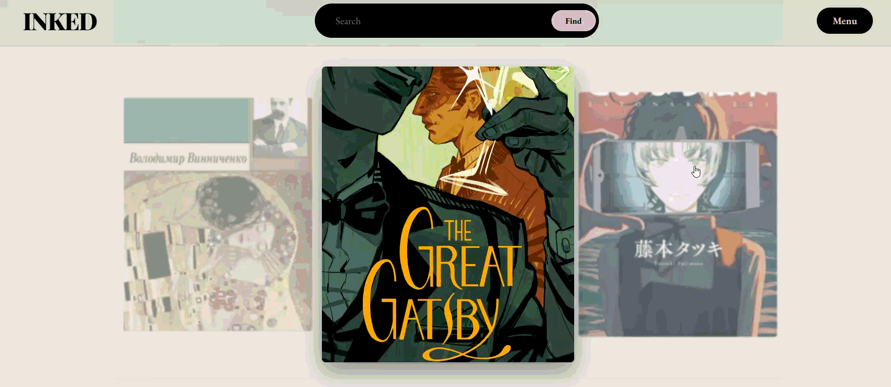
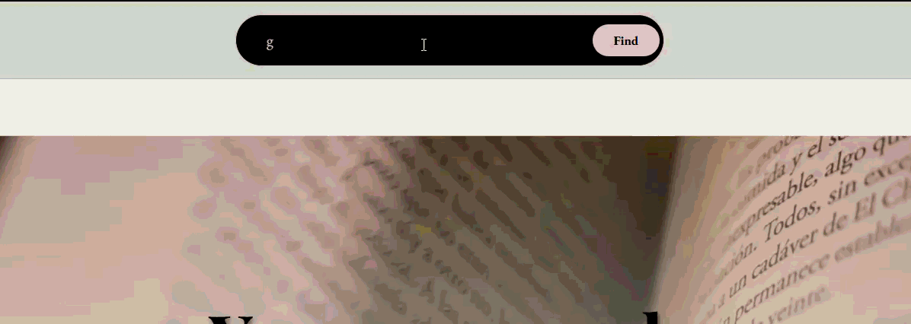

# Inked — Interactive Digital Library Platform

**Inked** is a feature-rich web platform and personal digital library designed for book lovers. It combines classic literature cataloging with interactive mini-apps, creative canvas tools, and a gothic/minimal visual aesthetic.

---

## Demo 

| Main Page & Carousel |
| :---: | 
|  | 

| React Live Search | Chalkboard Canvas |
| :---: | :---: |
|  |  |

---

## Key Features

### Core Library Experience
* **React Live Search:** Instant title & author search with debounced API queries and click-outside menu handling.
* **Reading Chronometry Calculator:** Interactive tool estimating book completion time based on page count, reading speed, and focus mode.
* **Multilingual Interface:** Seamless switching between Ukrainian and English with state saved in `localStorage`.
* **Dynamic Book Carousel:** Custom JavaScript carousel with bidirectional navigation and hover scaling effects.
* **Reading Session Stopwatch:** Real-time session timer tracking user reading duration.

### Interactive Minigames & Quests
* **Interactive Quest Room:** Explorable room built using HTML `<map>` and `<area>` image maps with interactive hotspots:
    * **Interactive Chalkboard:** HTML5 Canvas drawing board with freehand sketching and line smoothing.
    * **Literary Quiz:** Multi-question trivia challenge with real-time scoring.
    * **Constellation Atlas:** Interactive telescope minigame for stargazing and constellation identification.
* **The Oracle of Ink:** Fortune-telling minigame returning dynamic answers based on question intent (`when`, `where`, `who`).
* **Library Memory Game:** Book-cover matching card game with flip animations.

### User Accounts & Customization
* **Authentication:** Registration and Login forms with client-side validation and backend authentication API.
* **Profile Management:** Dynamic user profile page allowing users to update their bio, avatar path, nickname, and birthdate stored in PostgreSQL.

---

## Tech Stack

* **Frontend:** HTML5, CSS3 (Responsive Design & CSS Grid/Flexbox), JavaScript (ES6+), React 18 (via UMD/Babel for standalone components).
* **Backend:** Node.js, Express.js.
* **Database:** PostgreSQL (User profiles, session state, book catalog).
* **Tools & Deployment:** `pgAdmin 4`, `ngrok` (tunnelling for local testing), Docker-compatible structure.